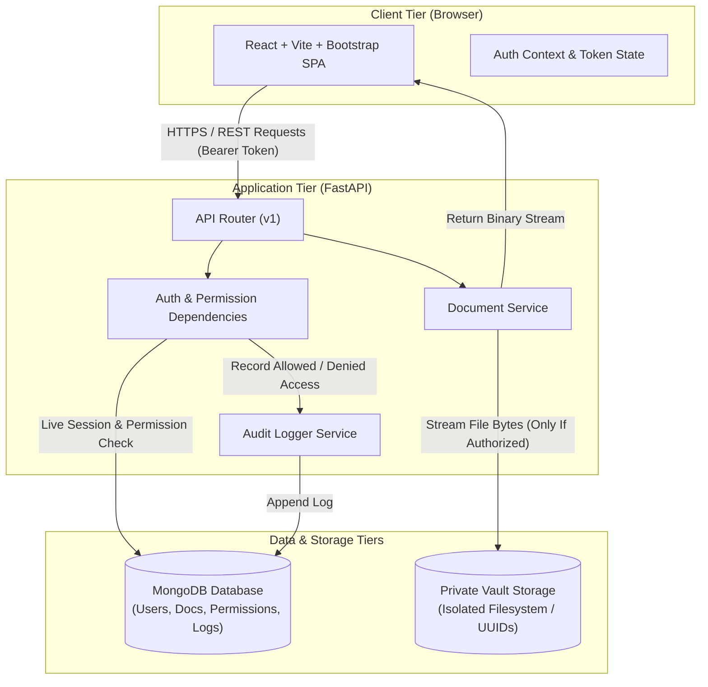

# TrustVault - System Architecture

> **Document Status**: **Planned Architecture Specification**  
> *Notice: This document outlines the planned design and component interactions for TrustVault. Implementation will proceed in subsequent steps.*

---

## 1. High-Level Architectural Overview

TrustVault uses a decoupled client-server architecture consisting of four core components:
1. **Client Tier (Frontend)**: Single Page Application built with React.js (via Vite) and styled with Bootstrap 5.
2. **API & Application Tier (Backend)**: Asynchronous REST API service built with Python and FastAPI.
3. **Database Tier**: Document database powered by MongoDB (accessed via the asynchronous driver Motor).
4. **Vault Storage Tier**: Private, isolated filesystem storage for encrypted or access-controlled binary document blobs.

---

## 2. Component Breakdown

### 2.1 Frontend: React.js (Vite) & Bootstrap
* **Responsibilities**:
  * Render an intuitive, responsive interface for uploading, viewing, downloading, and sharing documents.
  * Provide role-aware view logic (e.g., hiding Admin management panels from standard viewers).
  * Manage authentication state (JWT storage in memory or secure session storage) and attach the `Authorization: Bearer <token>` header to all outgoing requests.
  * Receive document download streams and initiate browser download triggers without exposing raw file paths.
* **Key Modules**:
  * `AuthContext`: Centralized provider for login, logout, current user profile, and active role.
  * `ProtectedRoute`: Client-side route wrapper preventing unauthorized navigation before server validation.
  * `DocumentDetail`: Interface for owners to inspect file details, view audit logs, and manage permissions.

---

### 2.2 Backend: FastAPI (Python 3.10+)
* **Responsibilities**:
  * Expose versioned REST endpoints (`/api/v1/...`).
  * Enforce strict, per-request authentication and permission checks using FastAPI's dependency injection system (`Depends()`).
  * Process multipart file uploads safely, validating file size and format.
  * Stream document contents to authorized clients using `StreamingResponse`.
  * Trigger real-time audit logs for both authorized operations and unauthorized attempts.
* **Key Modules**:
  * `api/deps.py`: Contains `get_current_user`, `require_role`, and `verify_document_access` dependencies executed on every protected endpoint.
  * `services/permission_service.py`: Evaluates ownership, explicit viewer grants, and revocation states against MongoDB.
  * `services/audit_service.py`: Generates immutable audit records.

---

### 2.3 Database: MongoDB
* **Responsibilities**:
  * Persist structured document metadata, user profiles, permission assignments, and audit trails.
* **Planned Collections**:
  1. `users`:
     * `_id`, `email`, `hashed_password`, `full_name`, `system_role` (`admin` or `user`), `is_active`, `created_at`.
  2. `documents`:
     * `_id`, `owner_id`, `original_filename`, `storage_path` (UUID filename), `file_size_bytes`, `mime_type`, `created_at`.
  3. `permissions`:
     * `_id`, `document_id`, `user_id`, `permission_level` (`viewer` or `editor`), `granted_by`, `granted_at`.
  4. `audit_logs`:
     * `_id`, `timestamp`, `actor_user_id`, `action` (`UPLOAD`, `DOWNLOAD`, `PERMISSION_GRANT`, `PERMISSION_REVOKE`, `ACCESS_DENIED`), `document_id`, `ip_address`, `status` (`SUCCESS` or `DENIED`), `details`.

---

### 2.4 Private Vault Storage (Filesystem Isolation)
* **Architecture Rules**:
  * **Not in Web Root**: The storage directory (`backend/storage/`) is strictly outside the reachable static web paths.
  * **Anonymized Filenames**: Files on disk are stored as randomly generated UUIDs (e.g., `storage/a3f2b8...bin`) to prevent directory traversal and local file inclusion (LFI) attacks.
  * **Access Exclusively via Streaming**: No direct URLs (e.g., `http://localhost:8000/files/document.pdf`) exist. All content is transferred through `GET /api/v1/documents/{id}/download`, ensuring permission is evaluated prior to streaming byte 1.
