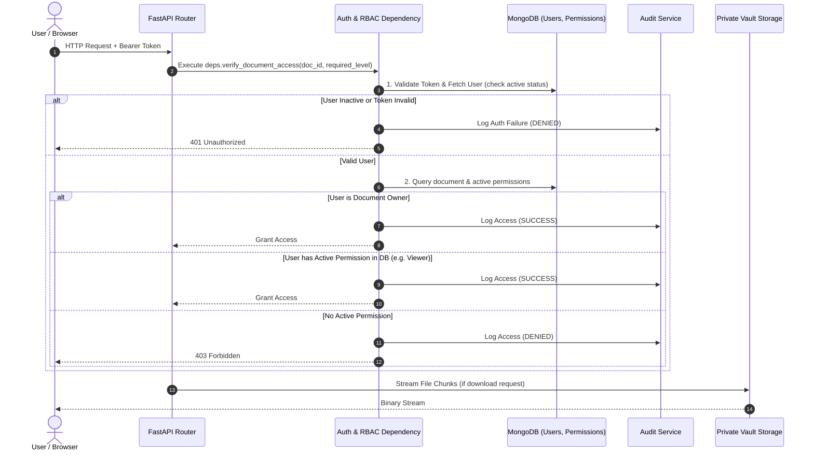

# TrustVault - Security Model & Access Control Architecture

> **Document Status**: **Planned Security Model Specification**  
> *Notice: This document defines the security policies, authorization rules, and enforcement mechanisms planned for TrustVault.*

---

## 1. Core Security Principles

TrustVault is built according to seven foundational security requirements:

1. **Active Verification per Request**: Authentication and current authorization rights are verified on every single protected API call.
2. **Private-by-Default Storage**: Documents are completely inaccessible via public web URLs or unauthenticated protocols.
3. **Instant Revocation**: Revoking a permission immediately stops any future download or view access, with no lingering access from cached tokens or reusable links.
4. **Comprehensive Audit Trails**: Both successful operations and denied attempts are immutably logged with actor, resource, action, and timestamp.
5. **Zero Credential Exposure**: Passwords are saved only as salted Bcrypt hashes; configuration and secrets are managed strictly through local environment variables.
6. **Explicit Human-in-the-Loop Permissions**: Permissions are granted solely through intentional, authenticated user actions. No AI suggestion or automated routine can autonomously alter or assign permissions.
7. **Cross-User Isolation & Verification**: Access boundaries between users are absolute and continuously validated through automated security test suites.

---

## 2. Authentication Architecture

### 2.1 Password Security
* **Hashing**: Salted `bcrypt` hashing with adaptive work factor (cost factor $\ge 12$).
* **Password Policy**: Minimum 8 characters, requiring at least one uppercase letter, one lowercase letter, one digit, and one special character.
* **Storage**: Only the hashed string (`hashed_password`) is stored in the MongoDB `users` collection. Plaintext passwords never touch disk or logs.

### 2.2 Session & Token Management
* **Mechanism**: JSON Web Tokens (JWT) signed with `HMAC-SHA256` using a 256-bit secret key.
* **Token Content**: The JWT payload contains only non-sensitive subject identifiers:
  ```json
  {
    "sub": "<user_uuid>",
    "role": "user",
    "exp": 1718880000,
    "iat": 1718876400
  }
  ```
* **Lifespan**: Short token lifetime (e.g., 30–60 minutes) to minimize exposure windows.
* **Important Design Decision**: Document-specific permissions are **never stored inside the JWT claims**. Doing so would make revocation delayed until token expiry. Instead, document permissions are checked live in the database on every request.

---

## 3. Server-Side Authorization & Role-Based Access Control (RBAC)

### 3.1 Role Hierarchy

| Role | Scope | Permitted Capabilities |
| :--- | :--- | :--- |
| **Admin** | System-wide | View user accounts, toggle user active status, review global audit logs. Cannot read private document blobs unless granted permission by the owner. |
| **Owner** | Document-specific | Read, download, delete their own documents. Grant or revoke Viewer permissions on their documents. View document-specific audit logs. |
| **Viewer** | Document-specific | Read document metadata and download document content for documents explicitly shared with them. Cannot alter permissions, re-share, or delete. |

---

### 3.2 Live Authorization Decision Flow

For every request targeting `/api/v1/documents/{document_id}/*`:



---

## 4. Immediate Revocation Architecture

In file-sharing systems, revocation failures frequently occur when systems issue pre-signed URLs with long timeouts or when permissions are cached client-side.

TrustVault guarantees **immediate revocation** through three design constraints:
1. **No Pre-Signed or Static URLs**: File downloads are served via `GET /api/v1/documents/{id}/download`, which executes database verification *synchronously* before transmitting file bytes.
2. **Synchronous Deletion**: When an owner calls `DELETE /api/v1/documents/{id}/permissions/{user_id}`, the permission document is removed from MongoDB in the same transaction.
3. **Zero In-Memory Permission Caching**: The API does not cache permission decisions in memory. The very next HTTP request issued by the revoked user immediately evaluates to `403 Forbidden`.

---

## 5. Audit Logging Architecture

### 5.1 Audit Record Schema
Every security-relevant operation logs an entry containing:
* `timestamp`: ISO-8601 UTC timestamp.
* `actor_user_id`: ID of the authenticated user (or `"anonymous"` if unauthenticated).
* `action`: Operation attempted (`AUTH_LOGIN`, `DOCUMENT_UPLOAD`, `DOCUMENT_DOWNLOAD`, `PERMISSION_GRANT`, `PERMISSION_REVOKE`, `ACCESS_ATTEMPT`).
* `document_id`: Target document ID (if applicable).
* `status`: `"SUCCESS"` or `"DENIED"`.
* `ip_address`: Client remote IP address.
* `reason`: Contextual reason for denial (e.g., `"INSUFFICIENT_PERMISSIONS"`, `"REVOKED_ACCESS"`, `"INVALID_TOKEN"`).

### 5.2 Log Protection & Immutability
* Audit logs are strictly **append-only**.
* No API routes exist to edit (`PUT`/`PATCH`) or delete (`DELETE`) audit records.
* Access to view logs is governed by RBAC:
  * Admins can view the global audit stream.
  * Owners can view logs strictly associated with documents they own.
  * Viewers cannot access audit logs.
