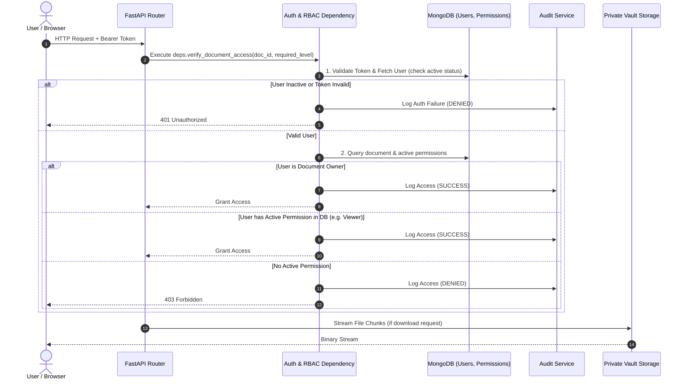

# TrustVault - Security Model & Access Control Architecture

> **Document Status**: **Partially Implemented**
> Authentication security (Argon2id hashing, JWT, live role resolution) and private document storage with owner-scoped upload/listing are implemented and tested.
> Permission management, download streaming, audit logging, and admin controls are planned.

---

## 1. Core Security Principles

TrustVault is built according to seven foundational security requirements:

1. **Active Verification per Request**: Authentication and current authorization rights are verified on every single protected API call.
2. **Private-by-Default Storage**: Documents are completely inaccessible via public web URLs or unauthenticated protocols.
3. **Instant Revocation**: Revoking a permission immediately stops any future download or view access, with no lingering access from cached tokens or reusable links.
4. **Comprehensive Audit Trails**: Both successful operations and denied attempts are immutably logged with actor, resource, action, and timestamp.
5. **Zero Credential Exposure**: Passwords are saved only as salted Bcrypt hashes; configuration and secrets are managed strictly through local environment variables.
6. **Explicit Human-in-the-Loop Permissions**: Permissions are granted solely through intentional, authenticated user actions. No AI suggestion or automated routine can autonomously alter or assign permissions.
7. **Cross-User Isolation & Verification**: Access boundaries between users are absolute and continuously validated through automated security test suites.

---

## 2. Authentication Architecture

### 2.1 Password Security
* **Hashing Algorithm**: `Argon2id` via `pwdlib[argon2]` with automatic salt generation per password. (Not bcrypt.)
* **Password Policy**: Minimum 8 characters, maximum 128 characters. Must contain at least one uppercase letter, one lowercase letter, and one digit.
* **Storage**: Only the Argon2id hash string (`hashed_password`) is stored in the MongoDB `users` collection. Plaintext passwords never touch disk, logs, or error messages.
* **Verification**: Constant-time comparison via `pwdlib.PasswordHash.verify()`. Inputs exceeding 128 characters are rejected before hash comparison to prevent CPU exhaustion attacks.

### 2.2 Session & Token Management
* **Mechanism**: JSON Web Tokens (JWT) signed with `HMAC-SHA256` (`HS256`) using the `SECRET_KEY` configured via environment variable.
* **Token Content**: The JWT payload contains only the minimal required claims. **No role or permission data is embedded.**
  ```json
  {
    "sub": "<user_uuid>",
    "iat": 1718876400,
    "exp": 1718877300
  }
  ```
* **Lifespan**: Default 15 minutes (configurable via `ACCESS_TOKEN_EXPIRE_MINUTES` in `.env`). Short lifetime minimises exposure if a token is intercepted.
* **Important Design Decision (Requirement 8)**: Document-specific permissions and user roles are **never stored inside the JWT claims**. On every protected request, the backend queries MongoDB for the user's current `role` and `is_active` status. A forged or stale role claim in the token is ignored.
* **Secret Key**: Loaded exclusively from the environment variable `SECRET_KEY`. The default placeholder value (`replace-with-a-long-random-secret-before-running`) must be replaced with a cryptographically random string of at least 32 bytes before running outside of tests.

---

## 3. Server-Side Authorization & Role-Based Access Control (RBAC)

### 3.1 Role Hierarchy

| Role | Scope | Permitted Capabilities |
| :--- | :--- | :--- |
| **Admin** | System-wide | View user accounts, toggle user active status, review global audit logs. Cannot read private document blobs unless granted permission by the owner. |
| **Owner** | Document-specific | Read, download, delete their own documents. Grant or revoke Viewer permissions on their documents. View document-specific audit logs. |
| **Viewer** | Document-specific | Read document metadata and download document content for documents explicitly shared with them. Cannot alter permissions, re-share, or delete. |

---

### 3.2 Live Authorization Decision Flow

For every request targeting `/api/v1/documents/{document_id}/*`:



---

## 4. Private Document Storage Security

### 4.1 Storage Location
Documents are stored on the server filesystem under the path configured by `STORAGE_PATH` (default: `backend/storage/`). This directory is **not** served by a web server and has no public URL.

### 4.2 Storage Path Design
* Each file is saved under a **UUID-based filename** generated at upload time. The original client-supplied filename is stored only in MongoDB metadata and is never used as the storage path.
* Files are further isolated in a **per-owner subdirectory** (`<STORAGE_PATH>/<owner_id>/<uuid>.<ext>`) to prevent cross-owner filesystem conflicts.
* The `storage_path` value is present in the MongoDB `documents` collection as a server-internal field. It is **never returned in any API response** and its absence in all document response schemas is verified by automated tests.

### 4.3 MIME Type Allowlist
Uploads are validated against a server-side allowlist of permitted MIME types (PDF, Word, Excel, plain text, JPEG, PNG). Any MIME type not explicitly listed is rejected with `415 Unsupported Media Type` before the file is written to disk.

### 4.4 Upload Validation
* **Size**: File content is read up to `MAX_UPLOAD_SIZE_MB + 1` bytes before checking. Uploads exceeding the limit are rejected with `413` without writing to disk.
* **Empty files**: Zero-byte uploads are rejected with `400 Bad Request`.
* **Orphan rollback**: If MongoDB metadata insertion fails after a file has been written to disk, the stored file is immediately deleted to prevent orphaned storage.

### 4.5 Owner-Scoped Listing
The `GET /api/v1/documents/` endpoint filters by `owner_id == current_user.id` at the database query level. Users can only list documents they own. Cross-user document visibility is never granted by this endpoint.

---

## 5. Immediate Revocation Architecture `[PLANNED]`

In file-sharing systems, revocation failures frequently occur when systems issue pre-signed URLs with long timeouts or when permissions are cached client-side.

TrustVault guarantees **immediate revocation** through three design constraints:
1. **No Pre-Signed or Static URLs**: File downloads are served via `GET /api/v1/documents/{id}/download`, which executes database verification *synchronously* before transmitting file bytes.
2. **Synchronous Deletion**: When an owner calls `DELETE /api/v1/documents/{id}/permissions/{user_id}`, the permission document is removed from MongoDB in the same transaction.
3. **Zero In-Memory Permission Caching**: The API does not cache permission decisions in memory. The very next HTTP request issued by the revoked user immediately evaluates to `403 Forbidden`.

---

## 6. Audit Logging Architecture `[IMPLEMENTED]`

### 6.1 Audit Record Schema
Every security-relevant operation creates an audit entry in the MongoDB `audit_logs` collection containing:
* `id` / `_id`: Unique UUID event identifier.
* `timestamp`: ISO-8601 UTC timestamp.
* `actor_id`: ID of the authenticated user when known (or `null` if unauthenticated).
* `action`: Operation name (`auth.login`, `document.upload`, `document.download`, `document.update`, `document.delete`, `permission.grant`, `permission.revoke`).
* `document_id`: Target document ID (if applicable).
* `outcome`: `"success"` or `"denied"`.
* `status_code`: HTTP status code (e.g. 200, 201, 204, 401, 403, 404).
* `reason`: Contextual safe reason (e.g. `"access_denied"`, `"invalid_credentials"`), actively sanitized and redacted.
* `correlation_id`: Request correlation ID extracted from `X-Correlation-ID` or `X-Request-ID` headers.

### 6.2 Security, Privacy & Reliability Guarantees
* **Strict Privacy Filter**: Audit records and responses never contain passwords, password hashes, JWT access tokens, `Authorization` headers, document contents, or server filesystem paths. All string fields are actively sanitized against credential and path regex patterns.
* **Fail-Safe Design**: Audit logging errors are trapped and logged safely so failures in audit persistence never crash business operations or expose secrets.
* **No Unprivileged Modification**: There are no API endpoints allowing users (or admins) to edit (`PUT`/`PATCH`) or delete (`DELETE`) audit events via the REST API.
* **Database Indexes**: Query performance is secured with indexes on `timestamp` (descending), compound `(action, timestamp)`, `(actor_id, timestamp)`, `(document_id, timestamp)`, and `(outcome, timestamp)`.
* **Honest Guarantee Note**: The audit trail uses standard MongoDB collections. While unprivileged users cannot modify or delete logs via the API, it is not claimed to be cryptographically tamper-proof or write-once-read-many (WORM) hardware verified.
* **Admin Inspection**: The `GET /api/v1/audit/` endpoint requires `role: "admin"` verified live against MongoDB. Non-admins are denied with `403 Forbidden`. Requests support pagination (`skip`, `limit`) and filtering by `action`, `outcome`, `actor_id`, `document_id`, `start_date`, and `end_date`.
